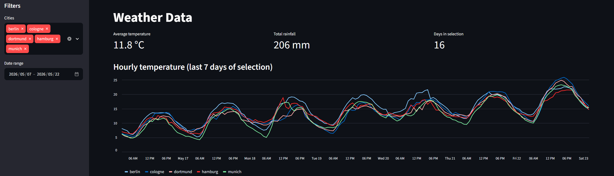
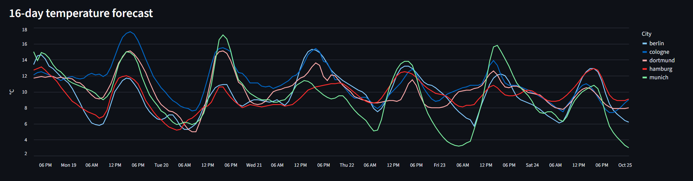

## Weather Data Pipeline

An end-to-end data engineering project: raw API data → PostgreSQL → dbt transformations → Streamlit dashboard.

**Stack:** Python · PostgreSQL · dbt · Streamlit · Altair · pandas · psycopg 3





---

## What it does

The pipeline pulls hourly weather data and a 16-day forecast for five German cities (Dortmund, Hamburg, Berlin, Munich, Cologne) from the free [Open-Meteo API](https://open-meteo.com/), stores the untouched API responses in Postgres, models them into analytics-ready tables with dbt, and serves them in a filterable streamlit dashboard.

```
Open-Meteo API ──► Python loader ──► Postgres (raw) ──► dbt ──► Postgres (analytics) ──► Streamlit
```

## Highlights

- **ELT-Pipeline:** Full API responses are landed as `JSON` in a `raw` schema first, then transformed inside the warehouse.
- **Organized into multiple schemes.** `raw` schema for source payloads, `analytics` schema for modelled fact tables (`fact_weather_hourly`, `fact_weather_daily`, `fact_weather_forecast`).
- **Interactive dashboard.** City and date-range filters, average temperature, total rainfall, days selected, hourly temperature and rainfall charts and a 16-day forecast chart with tooltips.
- **Query caching.** Dashboard queries are cached for 5 minutes to keep the UI fast and the database load low.
- **Secure configuration.** Database credentials are read from environment variables.
- **PostgresSql server with Docker** Required PostgresSQL Server was hosted locally and configured with Docker

## Data source

Weather data by [Open-Meteo.com](https://open-meteo.com/) (CC BY 4.0).
